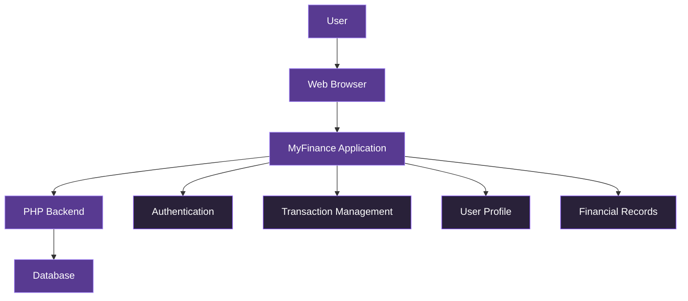
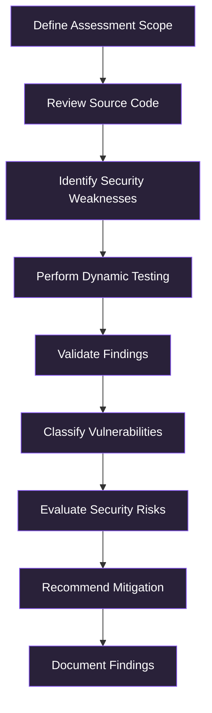
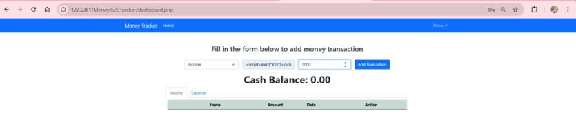
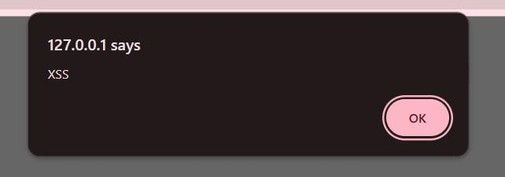
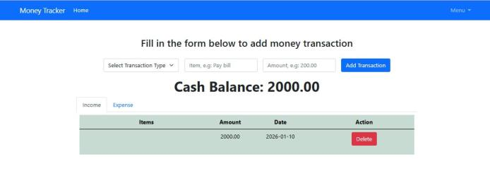
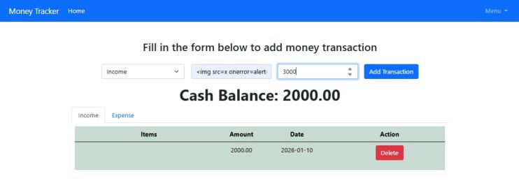
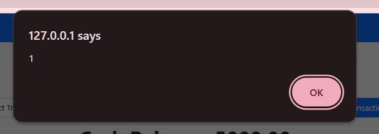
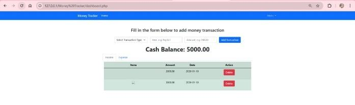

<div align="center">


*Assess. Identify. Validate. Secure.*

</div>

---

## 01 / Project Overview

An academic web application security assessment conducted by a four-member team to evaluate the security of MyFinance, a PHP-based personal financial tracking application.

The assessment combined white-box source code review and gray-box penetration testing to identify insecure coding practices, validate vulnerabilities, evaluate security risks and recommend corrective measures.

My individual contribution focused on Cross-Site Scripting (XSS) vulnerability analysis, practical exploitation and insecure output handling.

| Information | Details |
| --- | --- |
| Project Type | Group Academic Project |
| Team | TriadnError Security |
| Team Size | 4 Members |
| Course | ITT557 - Web Application Security |
| Domain | Cybersecurity & Application Security |
| Target Application | MyFinance Money Tracker |
| Assessment Duration | Approximately 2 Weeks |
| Testing Methodology | White-box and Gray-box |
| Individual Focus | Cross-Site Scripting (XSS) |
| Status | Completed |

## 02 / Project Objectives

- Conduct a comprehensive web application security assessment.
- Identify insecure coding practices within PHP source files.
- Perform manual source code review.
- Validate identified vulnerabilities through penetration testing.
- Assess vulnerability severity and potential security impacts.
- Classify security weaknesses using CWE identifiers.
- Recommend appropriate vulnerability mitigation techniques.
- Produce a structured technical security assessment report.

## 03 / Application Architecture



The diagram represents the logical application components evaluated during the security assessment.

## 04 / Tools & Technologies

| Technology | Purpose |
| --- | --- |
| PHP | Server-side source code analysis |
| MariaDB | Database security analysis |
| JavaScript | Client-side vulnerability testing |
| HTML | User input and output handling analysis |
| Web Browser | Dynamic vulnerability testing |
| CWE | Security weakness classification |
| OWASP | Web application security reference |

## 05 / Assessment Scope

The assessment was conducted within a controlled academic testing environment.

The testing scope included:

- User authentication.
- Session management.
- Financial transaction management.
- User profile functionality.
- Database interaction.
- User input processing.
- Application output handling.
- Access control mechanisms.
- Error handling and information disclosure.

Both authenticated and unauthenticated application behaviours were evaluated by the team.

## 06 / Security Assessment Methodology

### White-box Testing

Manual source code review was conducted to identify insecure implementation patterns.

- Reviewed PHP source files.
- Examined application input and output handling.
- Analysed database query construction.
- Investigated authentication logic.
- Reviewed access control mechanisms.
- Identified insecure coding practices.

### Gray-box Testing

Dynamic security testing was conducted using partial knowledge of the application's internal implementation.

- Examined application behaviour.
- Tested identified vulnerability hypotheses.
- Validated selected security weaknesses.
- Documented observable exploitation results.
- Evaluated potential security impacts.

### Assessment Workflow



## 07 / Group Security Assessment Findings

The team identified multiple security weaknesses across the MyFinance application.

| Vulnerability Category | Classification |
| --- | --- |
| SQL Injection | CWE-89 |
| Cross-Site Scripting | CWE-79 |
| Missing Authentication | CWE-306 |
| Broken Access Control / IDOR | CWE-639 |
| Plaintext Password Storage | CWE-256 |
| Improper Input Validation | CWE-20 |
| Error Handling & Information Disclosure | CWE-209 |

These findings represent the collective security assessment conducted by the team.

## 08 / Individual Contribution

My primary responsibility was identifying and investigating Cross-Site Scripting vulnerabilities.

### Responsibilities

- Reviewed PHP source files for insecure output handling.
- Investigated user-controlled application data.
- Identified potential JavaScript injection points.
- Performed practical Stored XSS testing.
- Verified persistent JavaScript execution.
- Classified identified weaknesses using CWE-79.
- Analysed vulnerability root causes.
- Recommended secure output encoding practices.
- Contributed to the final security assessment report.

## 09 / Cross-Site Scripting (XSS) Assessment

### Vulnerability Overview

Cross-Site Scripting occurs when an application renders untrusted data without appropriate security controls, allowing executable content to run within a user's browser.

Stored XSS occurs when injected content is retained by the application and subsequently displayed to users.

| Information | Details |
| --- | --- |
| Vulnerability | Cross-Site Scripting |
| Classification | CWE-79 |
| Primary Focus | Stored XSS |
| Attack Surface | User-controlled application data |
| Root Cause | Insecure output handling |
| Testing Result | Stored XSS successfully demonstrated |

### Source Code Review Findings

| Source File | Identified Weakness | Reported Risk |
| --- | --- | --- |
| list.php | Unescaped output of user-controlled transaction items | High |
| editprofile.php | Unescaped user data within HTML attributes | Medium |
| index.php | Unescaped session notification data within JavaScript | High |
| register.php | Unescaped session notification data within JavaScript | High |

The Stored XSS vulnerability in `list.php` was validated through practical testing.

The remaining source code findings represent identified security weaknesses and potential injection paths requiring further validation.

### Root Cause Analysis

- User-controlled content rendered directly through PHP output functions.
- Missing context-appropriate output encoding.
- Insufficient handling of untrusted application data.
- Unsafe insertion of data into HTML and JavaScript contexts.

## 10 / Practical Vulnerability Testing

The Stored XSS assessment focused on validating whether user-controlled application content could be stored and subsequently executed within the browser.

### Testing Workflow

- Identified an application input field.
- Reviewed the corresponding PHP output handling.
- Submitted controlled JavaScript test input.
- Examined the application response.
- Verified persistent script execution.
- Documented the vulnerability and associated security risks.

### Practical Demonstration 1 — Script Injection

#### Payload Injection



*Figure 1: Script injection through a transaction input field.*

#### JavaScript Execution



*Figure 2: Browser alert demonstrating successful JavaScript execution.*

#### Stored Transaction



*Figure 3: Transaction record containing the injected content.*

### Practical Demonstration 2 — Image-Based XSS

#### Alternative Payload Injection



*Figure 4: Testing an alternative image-based XSS payload.*

#### JavaScript Execution Verification



*Figure 5: Browser alert confirming JavaScript execution.*

#### Stored Transaction Records



*Figure 6: Stored transaction records associated with vulnerability testing.*

### Testing Results

| Test Case | Outcome |
| --- | --- |
| User-controlled input analysis | Completed |
| PHP output handling review | Insecure output identified |
| Stored XSS testing | Successfully demonstrated |
| Script-based XSS testing | Successful |
| Image-based XSS testing | Successful |
| Persistent JavaScript execution | Verified |
| Vulnerability classification | CWE-79 |
| Mitigation recommendation | Documented |

The practical testing demonstrated the security risks associated with rendering untrusted transaction data without appropriate output encoding.


## 11 / Potential Security Impact

Successful exploitation of Cross-Site Scripting vulnerabilities may result in:

- Unauthorized JavaScript execution.
- Session compromise.
- Account impersonation.
- Application content manipulation.
- Unauthorized browser redirection.
- Exposure of sensitive financial information.
- Reduced application integrity and user trust.

These are potential security consequences rather than confirmed outcomes of the academic testing.

## 12 / Vulnerability Mitigation

### XSS Mitigation Recommendations

| Security Control | Purpose |
| --- | --- |
| Context-appropriate Output Encoding | Prevent untrusted data from executing as code |
| Input Validation | Restrict data to expected formats |
| HTML Sanitization | Remove unsafe markup when HTML input is permitted |
| Content Security Policy | Provide additional browser-level protection |
| Secure Cookie Attributes | Reduce certain session-related risks |
| Secure Coding Practices | Prevent insecure handling of application content |

### Secure PHP Output Handling

For untrusted data rendered as HTML text, context-appropriate encoding should be applied before displaying the content.

```php
echo htmlspecialchars($user_controlled_data, ENT_QUOTES, 'UTF-8');
```

JavaScript contexts require separate, context-specific handling rather than relying solely on HTML encoding.

### Additional Team Recommendations

- Use prepared statements for database queries.
- Implement secure password hashing.
- Enforce authentication and session guards.
- Regenerate session identifiers after authentication.
- Implement server-side access control verification.
- Improve error handling and information disclosure protection.

These recommendations were documented as corrective measures. Their implementation and effectiveness were not independently verified as part of this portfolio case study.

## 13 / Project Outcomes

- Participated in a four-member web application security assessment team.
- Conducted manual PHP source code review.
- Identified insecure application output handling.
- Successfully demonstrated Stored XSS.
- Verified persistent JavaScript execution.
- Classified vulnerabilities using CWE identifiers.
- Evaluated vulnerability severity and potential security impacts.
- Recommended appropriate secure coding practices.
- Contributed to a comprehensive security assessment report.

## 14 / Technical Skills Developed

- Web application penetration testing
- White-box security testing
- Gray-box security testing
- Manual source code review
- PHP security analysis
- Cross-Site Scripting analysis
- Vulnerability assessment
- Vulnerability classification
- Security risk assessment
- Secure coding fundamentals
- Application security
- Technical security reporting
- Cybersecurity teamwork

## 15 / Repository Structure

```text
myfinance-web-security-assessment/
├── README.md
├── documentation/
│   ├── source-code-review.md
│   └── mitigation.md
└── screenshots/
    ├── README.md
    ├── xss-script-input.png
    ├── xss-script-alert.png
    ├── xss-first-transaction.png
    ├── xss-image-input.png
    ├── xss-image-alert.png
    └── xss-stored-transactions.png
```

### Additional Documentation

- [White-box Source Code Security Review](./documentation/source-code-review.md)
- [Security Mitigation Recommendations](./documentation/mitigation.md)
- [Practical Security Testing Evidence](./screenshots/)

## 16 / Future Improvements

- [ ] Integrate automated static application security testing.
- [ ] Integrate dynamic application security testing.
- [ ] Expand testing using Burp Suite.
- [ ] Apply standardized CVSS risk scoring.
- [ ] Implement secure coding improvements in a test environment.
- [ ] Conduct post-remediation security testing.
- [ ] Develop automated security regression tests.
- [ ] Integrate security testing into a CI/CD pipeline.

## 17 / Learning Resources

- [OWASP Top 10](https://owasp.org/www-project-top-ten/)
- [OWASP Web Security Testing Guide](https://owasp.org/www-project-web-security-testing-guide/)
- [OWASP XSS Prevention Cheat Sheet](https://cheatsheetseries.owasp.org/cheatsheets/Cross_Site_Scripting_Prevention_Cheat_Sheet.html)
- [CWE-79: Cross-Site Scripting](https://cwe.mitre.org/data/definitions/79.html)

## 18 / Disclaimer

This repository documents an academic web application security assessment conducted within an authorized and controlled testing environment.

The overall assessment findings reflect the collective work of the project team, while the individual contribution section highlights my personal responsibilities in Cross-Site Scripting vulnerability analysis and testing.

---

<div align="center">

*Explore. Learn. Secure. Repeat.*

[GitHub Profile](https://github.com/rosinss)


</div>
